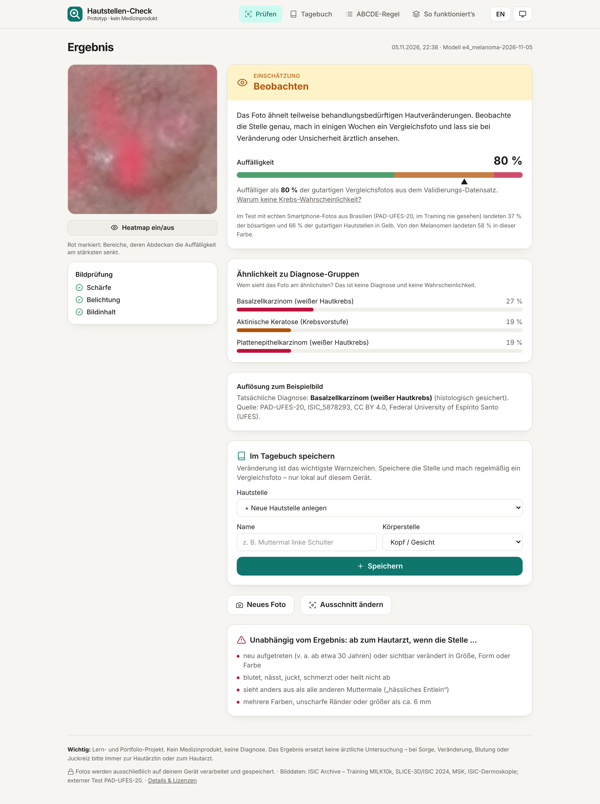

# Skin Spot Check – skin cancer triage from phone photos (ISIC)

[Deutsch](README.md) · **English**

Take a photo of a mole or skin spot → a small neural network estimates **directly in the browser**
how conspicuous it looks: as a **traffic light** (inconspicuous · keep an eye on it · have it
checked) and as a **percentage** (“more conspicuous than 87% of benign reference photos”). Plus a
**mole diary** that makes changes over time visible, and the **ABCDE rule** for self-checks. The
photo never leaves the device.

> Learning and portfolio project. **Not a medical device**, no diagnosis, does not replace a doctor.



<!-- RESULTS:START -->
## Results

Model `e4_melanoma` (MobileNetV3-Large, 128 px, ONNX 9.0 MB).
Configuration chosen on validation only; test and external test were evaluated **once** at the end.

| Dataset | malignant / benign | AUROC [95% CI] | pAUC80 | Sensitivity yellow+red | Specificity (not red) |
|---|---:|---:|---:|---:|---:|
| Internal test · camera photos | 552 / 436 | 0.936 [0.907–0.955] | 0.161 | 98.7% | 94.0% |
| Internal test · 3D TBP crops | 42 / 20000 | 0.945 [0.915–0.972] | 0.159 | 88.1% | 99.2% |
| Internal test · dermoscopy | 547 / 186 | 0.873 [0.842–0.908] | 0.128 | 99.5% | 90.3% |
| **External · PAD-UFES-20 (smartphone)** | 1089 / 479 | 0.916 [0.903–0.931] | 0.138 | 98.9% | 95.8% |

**Traffic light on real smartphone photos** (PAD-UFES-20, Brazil, never seen in training; thresholds
taken unchanged from validation):

| PAD-UFES-20 | n | green | yellow | red |
|---|---:|---:|---:|---:|
| malignant | 1089 | 1.1% | 37.0% | 61.9% |
| actinic keratosis (precursor) | 730 | 4.7% | 63.4% | 31.9% |
| benign | 479 | 30.1% | 65.8% | 4.2% |

- **Ranking transfers:** AUROC internal 0.936 → external 0.916 (different clinic, cameras, country).
- **Thresholds transfer worse:** benign photos kept green internally 66.5%, on the foreign phone photos only 30.1% – most end up yellow. The model is more “nervous” with unfamiliar cameras. Thresholds were deliberately not re-tuned on PAD-UFES-20, otherwise the test would no longer be external.
- **Melanomas:** internally 5.1% green (n = 79), externally 51 of 52 yellow/red; AUROC melanoma vs. nevus 0.772 internal, 0.854 external.
- **“Cannot be assessed” rarely triggers:** only 0.5% of SCIN phone photos (mostly rashes) are rejected. The app is meant for single spots; for rashes the result is meaningless.
<!-- RESULTS:END -->

## Data

The large public collection of skin images is the **ISIC archive** (> 500,000 images). Because phone
photos look different from dermoscopy (contact microscope) images, the project mainly uses
**phone-like image types**: clinical camera photos (MILK10k, MSK) and crops from 3D total-body
photography (SLICE-3D / ISIC 2024). **PAD-UFES-20** (real smartphone photos from Brazil) is never
used for training or model selection – it is the external test. Google **SCIN** (crowdsourced phone
photos, mostly rashes) only tests the “cannot be assessed” check.

## Method

- Splits grouped by patient **or** lesion (union-find) – no leakage between train/val/test.
- Domain-balanced sampler (image type × malignant) so the network cannot learn “clinic photo =
  cancer”.
- 7 diagnosis groups with set-valued labels (if only “benign” is known, the sum of benign groups
  is maximized); triage score = log P(malignant) − log P(not malignant).
- MobileNetV3-Large, 128 × 128 px, AdamW + cosine + EMA, phone-realism augmentation, trained on a
  4-core CPU.
- Traffic light thresholds set on validation only (yellow at 95% sensitivity, red at 90%
  specificity); the percentage is a percentile among benign validation photos (prevalence-free).
- “Cannot be assessed”: PCA-Mahalanobis + reconstruction error on embeddings.
- One ONNX graph with normalization, 4× test-time augmentation, score and OOD distance; float16
  weights; parity tests PyTorch ↔ ONNX and Python ↔ JavaScript.

## Quick start

```bash
make install data preprocess baseline
make train CONFIG=configs/e1_mix.json RUN=artifacts/runs/e1_mix
make final RUN=…    # once: validation + test + external
make export RUN=…   # ONNX + meta.json + metrics.json -> web/public
make test web && node scripts/web_smoke.mjs
```

## License

Code: MIT. Data and trained model: see [DATA_LICENSE.md](DATA_LICENSE.md) (parts CC BY-NC →
model for non-commercial use only).
