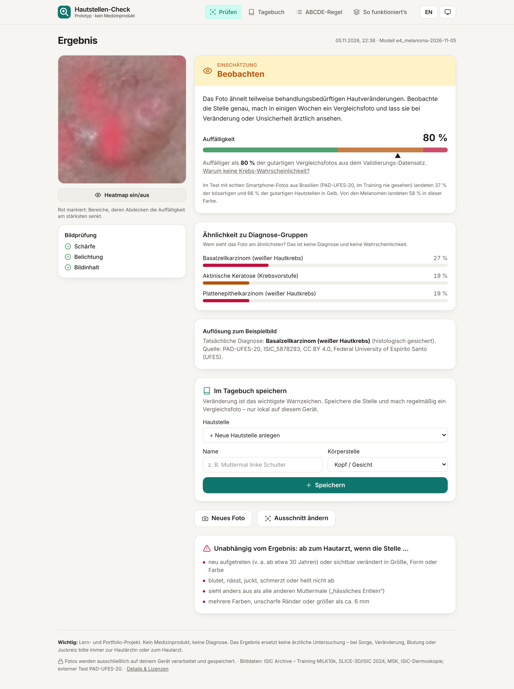

# Hautstellen-Check – Hautkrebs-Triage aus Handyfotos (ISIC)

**Deutsch** · [English](README.en.md)

Ein Foto von einem Muttermal oder einer Hautstelle → ein kleines neuronales Netz schätzt
**direkt im Browser** ein, wie auffällig die Stelle aussieht: als **Ampel** (unauffällig ·
beobachten · ärztlich abklären) und als **Prozentzahl** („auffälliger als 87 % der gutartigen
Vergleichsfotos“). Dazu ein **Muttermal-Tagebuch**, das Veränderungen über die Zeit sichtbar macht,
und die **ABCDE-Regel** zum Selbst-Check. Das Foto verlässt dabei nie das Gerät.

> Lern- und Portfolio-Projekt. **Kein Medizinprodukt**, keine Diagnose, ersetzt keinen Arztbesuch.



**Fragen und Antworten:** [docs/ERKLAERT.md](docs/ERKLAERT.md) · **Experiment-Protokoll:**
[docs/EXPERIMENTS.md](docs/EXPERIMENTS.md) · **Daten & Lizenzen:** [DATA_LICENSE.md](DATA_LICENSE.md)

<!-- RESULTS:START -->
(Ergebnisse folgen)
<!-- RESULTS:END -->

## Was die App kann

| Ansicht | Funktion |
|---|---|
| **Prüfen** | Foto aufnehmen oder wählen → Ausschnitt per Ziehen/Zoomen → Bildprüfung (Schärfe, Belichtung, „kennt das Modell so etwas?“) → Ampel, Auffälligkeit in %, Ähnlichkeit zu 7 Diagnose-Gruppen, Verdeckungs-Heatmap („wohin schaut das Modell?“), Warnzeichen. Vier zufällig gewählte echte Smartphone-Fotos (PAD-UFES-20) zum Ausprobieren, inkl. Auflösung der echten Diagnose. |
| **Tagebuch** | Hautstellen anlegen, Fotos im Verlauf, Vergleich zweier Termine (nebeneinander und überblendet), Verlaufskurve, Hinweis nach 90 Tagen, Export/Import als Datei. Alles lokal (IndexedDB). |
| **ABCDE-Regel** | Asymmetrie, Begrenzung, Farbe, Durchmesser, Entwicklung mit Illustrationen, „hässliches Entlein“, weißer Hautkrebs, interaktive Checkliste. |
| **So funktioniert’s** | Pipeline, Daten, ROC-Kurven, Ampel-Verteilung intern und extern, Hauttypen, Diagnose-Gruppen, Trainingsverlauf, Experimente, Grenzen, Lizenzen. |

Technik: Vite, Tailwind CSS v4, Vanilla-JS, **onnxruntime-web** (WebAssembly), Service Worker
(offline-fähig, installierbar), Deutsch/Englisch, hell/dunkel.

## Daten

Die große öffentliche Sammlung für Hautbilder ist das **ISIC-Archiv** (International Skin Imaging
Collaboration, > 500 000 Bilder) – es spielt hier die Rolle, die MIT-BIH im EKG-Projekt spielt.
Weil Handyfotos anders aussehen als Dermoskopie-Bilder (Auflichtmikroskop), nutzt das Projekt vor
allem **handyähnliche Bildarten**:

| Quelle | Bildart | verwendet als |
|---|---|---|
| MILK10k | Kamerafoto **und** Dermoskopie derselben Läsion (5 240 Läsionen) | Train / Val / Test |
| SLICE-3D (ISIC 2024) | Ausschnitte aus 3D-Ganzkörperfotos, „vergleichbar mit Smartphone-Auflösung“; 401 059 Bilder, nur 393 bösartig | Train / Val / Test (Stichprobe der Gutartigen, gewichtet) |
| MSK (ISIC-Archiv) | Kamerafotos, überwiegend gutartig | Train / Val / Test |
| **PAD-UFES-20** | **echte Smartphone-Fotos**, Brasilien, 1 373 Patienten | **nur externer Test** – nie im Training |
| Google SCIN | crowdsourced Handyfotos (meist Ausschläge) | nur Test für „nicht beurteilbar“ |

Alles ist von dieser Umgebung aus über den öffentlichen ISIC-S3-Bucket erreichbar (`make data`);
PhysioNet, Kaggle und Hugging Face werden nicht gebraucht.

## Methode in Kürze

- **Splits nach Gruppe:** Bilder, die Patient **oder** Läsion teilen, hängen über Union-Find
  zusammen und liegen immer im selben Split (Kamerafoto und Dermoskopie einer Läsion inklusive).
- **Domänen-balancierter Sampler:** jeder Batch enthält feste Anteile je Bildart × bösartig/nicht –
  sonst lernt das Netz „Klinikfoto = Krebs“ (MILK10k: 70 % bösartig, SLICE-3D: 0,1 %).
- **7 Diagnose-Gruppen mit Mengen-Labels:** Melanom, Basalzell-, Plattenepithelkarzinom, aktinische
  Keratose, Nävus, gutartige Keratose, andere. Ist nur „gutartig“ bekannt, wird die Summe der
  gutartigen Gruppen maximiert. Triage-Score = log P(bösartig) − log P(nicht bösartig).
- **Netz:** MobileNetV3-Large (ImageNet-vortrainiert, Gewichte aus den timm-GitHub-Releases),
  128 × 128 px, AdamW + Cosinus + EMA, Augmentierung für Handy-Realismus. Training auf 4 CPU-Kernen.
- **Ampel:** Schwellen nur auf Validierung (Kamerafotos): Gelb ab 95 % Sensitivität, Rot ab 90 %
  Spezifität. **Prozent:** Perzentil unter gutartigen Validierungsfotos – unabhängig von der
  Prävalenz, anders als eine „Krebs-Wahrscheinlichkeit“.
- **„Nicht beurteilbar“:** PCA-Mahalanobis + Rekonstruktionsfehler auf den Embeddings,
  Schwelle = 99. Perzentil der Validierung.
- **Export:** ein ONNX-Graph mit Normalisierung, 4-facher Test-Time-Augmentation, Score und
  OOD-Abstand; float16-Gewichte. Ein Test prüft PyTorch ↔ ONNX, ein weiterer Python ↔ JavaScript.

## Schnellstart

```bash
make install        # venv + Paket + npm
make data           # ~3 GB aus dem ISIC-Archiv + SCIN
make preprocess     # Katalog, Splits, 160-px-Memmap (~6,6 GB)
make baseline       # E0: lineare Probe auf ImageNet-Merkmalen
make train CONFIG=configs/e1_mix.json RUN=artifacts/runs/e1_mix
make evaluate RUN=artifacts/runs/e1_mix          # nur Validierung
make final RUN=…    # einmalig: Val + Test + extern
make export RUN=…   # ONNX + meta.json + metrics.json -> web/public
make test web       # Python-Tests, Web-Build
node scripts/web_smoke.mjs   # Ende-zu-Ende-Test im Browser + Screenshots
```

Einzelne Fotos auf der Kommandozeile bewerten (gleiche Logik wie die App):

```bash
.venv/bin/python -m skintriage.cli predict foto1.jpg foto2.jpg
```

## Projektstruktur

```
src/skintriage/
  data/        download, catalog (Labels, Gruppen, Splits), preprocess (Memmap)
  models/      net (MobileNetV3 + Kopf), losses (Mengen-Labels), infer (TTA)
  training/    augment (Batch-Augmentierung), data (Sampler), train
  evaluation/  metrics, triage (Ampel/Perzentil), ood, run, baseline
  export/      onnx_export, web_export, quality, predict
web/           Vite-App (views: check, diary, abcde, about)
configs/       Experiment-Konfigurationen
tests/         pytest (Labels, Leakage, Metriken, Modell, ONNX- und JS-Parität)
```

## Grenzen

- Kein Medizinprodukt; in der EU wäre so eine App nach MDR mindestens Klasse IIa.
- Trainingsbilder stammen aus Kliniken und Screening, nicht von Laien-Handyfotos.
- Dunkle Hauttypen sind stark unterrepräsentiert.
- Teile der Labels beruhen auf klinischer Einschätzung statt Histologie.
- Bekannte Abkürzungen in Hautbild-Daten (Stiftmarkierungen, Lineale, Dermoskop-Ränder).
- Ein Foto zeigt keine Veränderung über die Zeit – deshalb das Tagebuch.

## Lizenz

Code: MIT. Daten und das trainierte Modell: siehe [DATA_LICENSE.md](DATA_LICENSE.md)
(Teile CC BY-NC → Modell nur nicht-kommerziell).
